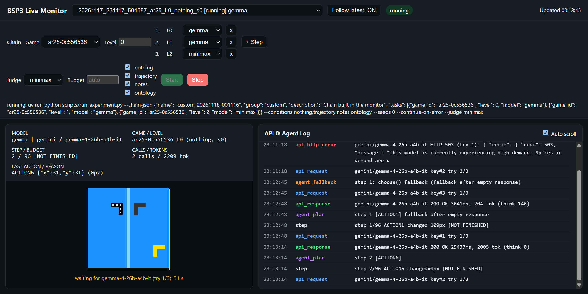

# Transfer Learning Between Interactive Reasoning Agents in ARC-AGI-3

Bachelor Semester Project 3 (BSP3) at the University of Luxembourg, by Can Yıldız and Nina, supervised by Matteo Magnini.

## The idea

In ARC-AGI-3 an agent starts a game without knowing the rules or the goal. It tries actions, watches what changes and works the game out as it plays. When the next game starts, everything it figured out is usually gone.

We want to know whether that knowledge can be passed on. A first agent plays a game and writes down what it learned: which objects matter, how they move, what seems to finish a level. The next agent reads those notes before playing a related task, usually the next level or a game with similar rules, then adds what it learns itself. A third agent gets the notes of both. Over 3 to 10 tasks this becomes a chain of agents, each starting from what the previous ones left behind.

Two questions drive the project. Do later agents need fewer actions and model calls? And does it matter how the knowledge is written down?

## How we test it

Each later agent plays its task once under each of four conditions:

| Condition | What the agent gets |
|---|---|
| Baseline | nothing |
| Full trajectory | every observation and action of the earlier agents |
| Notes | notes on the game's rules, in plain language |
| Ontology | the same knowledge as facts in a small OWL ontology |

The full trajectory is a control: without it, an improvement could just mean a longer prompt. Notes and facts hold general rules only, so an agent can't copy a solution. Later agents always play a different task from the earlier ones, because replaying the same level with someone else's moves would be copying too. Each run has an action budget, by default three times the human baseline for that level. For every run we record success, actions, model calls, tokens and time.

## How it works

A grounding step turns each game frame into symbols (objects, positions, what changed) and passes them on as JSON. A language model reads that state and picks the next action. The agent only talks to an oracle interface, so any other subsymbolic model could take its place.

Knowledge that moves between agents stays symbolic. Before a fact enters the ontology, a judge checks it against what the agent actually observed, and flags notes that give away a solution.

## Models

MiniMax M3.1 Flash runs the main experiments. Gemma 4 26B and Qwen 3.5 9B repeat a smaller set of runs, so we can see whether the results hold for other models, including a small one. MiniMax uses NVIDIA's free endpoint, Gemma uses Google AI Studio and rotates between several API keys, and Qwen runs on the university's HPC cluster over an SSH tunnel. Each agent writes its notes with its own model, and the judge runs on MiniMax by default.

## Setup

You need Python 3.12 and [uv](https://docs.astral.sh/uv/).

```bash
uv sync
cp .env.example .env
```

Add your ARC-AGI-3 key (from [arcprize.org/platform](https://arcprize.org/platform)) and model API keys to `.env`. Running Qwen also needs an HPC account (see `docs/HPC.md`).

## Usage

Start the project and open the live monitor:

```bash
python start.py
```

The monitor shows the board and the model calls of the active run, and you can open older runs from the list. To start a chain, pick a game and a starting level, then add one step per agent and choose its model. Each step plays one level higher than the one before. Pick the judge, the conditions and an optional budget, then press Start. Stop ends the whole chain.



Run the tests (mock answers, no API keys):

```bash
uv run python -m unittest discover -s tests -v
```

Run an experiment suite (`--resume` skips runs that already finished):

```bash
uv run python scripts/run_experiment.py --suite pilot --model minimax --dry-run
uv run python scripts/run_experiment.py --suite cross --model minimax --resume --continue-on-error
```

Collect the logged runs into `runs/results_summary.csv` and `runs/results_summary.md`:

```bash
uv run python scripts/summarize_runs.py
```

Settings live in `configs/`, prompts in `prompts/`, and the code in `bsp3/`.
